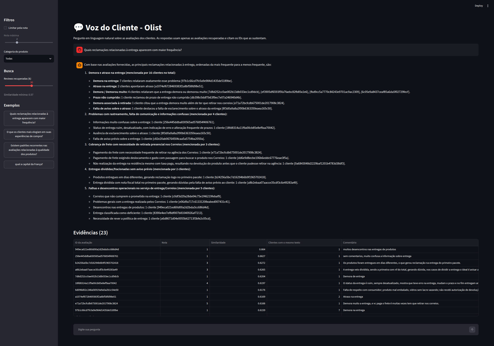

# 💬 Voice of Customer Intelligence com RAG

> **Tech Challenge – Fase 4 | PosTech FIAP | IA Scientist**

---

## 👥 Equipe

Projeto desenvolvido para o **Tech Challenge – Fase 4 da PosTech FIAP**

* **Gabriela de Lima Lopes** (RM372467) ➔ [](https://www.linkedin.com/in/gabrieladelimalopes/)
* **Vitor Lopes Rodrigues** (RM372427) ➔ [](https://www.linkedin.com/in/vitor-lopes-rodrigues/)
* **Lucas Oliveira dos Santos Lima** (RM372651) ➔ [](https://www.linkedin.com/in/lucasoslima/)
* **Mateus Quintino Vieira dos Santos** (RM371795) ➔ [](https://www.linkedin.com/in/mateusqsantos/)

---

Solução de **Voice of Customer** baseada em **Retrieval-Augmented Generation (RAG)** sobre as avaliações do [Brazilian E-Commerce Public Dataset by Olist](https://www.kaggle.com/datasets/olistbr/brazilian-ecommerce). Gestores e analistas fazem perguntas em linguagem natural e recebem respostas fundamentadas em avaliações reais, com a lista das evidências usadas e recusa explícita quando a base não tem informação suficiente.

## Sumário

- [Problema de negócio](#problema-de-negócio)
- [Arquitetura](#arquitetura)
- [Tecnologias e bibliotecas](#tecnologias-e-bibliotecas)
- [Estrutura do repositório](#estrutura-do-repositório)
- [Preparação da base](#preparação-da-base)
- [Instalação](#instalação)
- [Como executar](#como-executar)
  - [1. Preparar a base de conhecimento](#1-preparar-a-base-de-conhecimento)
  - [2. Usar via linha de comando (CMD)](#2-usar-via-linha-de-comando-cmd)
  - [3. Usar via Streamlit](#3-usar-via-streamlit)
  - [4. Avaliar o pipeline](#4-avaliar-o-pipeline)
- [Exemplos de perguntas e respostas](#exemplos-de-perguntas-e-respostas)
- [Decisões técnicas](#decisões-técnicas)
- [Limitações conhecidas](#limitações-conhecidas)

## Problema de negócio

Um e-commerce recebe milhares de avaliações. A nota (1 a 5) mede satisfação, mas os motivos estão nos comentários em texto, que são difíceis de ler em escala. Esta solução transforma os comentários em uma base explorável. Perguntas que ela responde:

- Quais são os principais problemas relatados pelos clientes?
- Quais reclamações de entrega aparecem com mais frequência?
- O que os clientes mais elogiam?
- Quais problemas aparecem nas avaliações com nota baixa ou em uma categoria específica?
- Quais avaliações sustentam determinada conclusão?

Requisitos que guiam o projeto: toda resposta cita as avaliações usadas, e perguntas sem suporte nos dados (ou fora do escopo) recebem uma recusa, não uma resposta inventada.

## Arquitetura

```
 Pergunta do usuário  (+ filtros opcionais: nota máxima, categoria)
          │
          ▼
 1. Embedding da pergunta        paraphrase-multilingual-MiniLM-L12-v2
          │
          ▼
 2. Busca semântica              ChromaDB (cosseno), top-k = 30, com filtro por metadados
          │
          ▼
 3. Filtro de relevância         descarta similaridade < 0,57
          │                      └─ nada sobrou? → recusa, SEM chamar o LLM
          ▼
 4. Agrupamento de repetidas     textos idênticos viram 1 evidência + contagem de clientes
          │
          ▼
 5. Construção do contexto       [review_id] (nota, categoria, nº de clientes): texto
          │
          ▼
 6. Geração                      Gemini (temperatura 0), prompt que exige citar [review_id]
          │
          ▼
 Resposta + evidências           review_id, nota, similaridade, ocorrências, trecho
```

A indexação (offline) segue outro fluxo:

```
 CSVs do Kaggle → download_data → preprocess (limpeza + metadados) → embedder → ChromaDB (data/vectorstore)
```

### Prevenção de alucinação (duas camadas)

1. **Limiar de similaridade:** perguntas fora do escopo (ex.: "qual a capital da França?") não têm avaliações acima de 0,57 e são recusadas antes de chamar o modelo.
2. **Regras no prompt:** o modelo só pode usar as avaliações do contexto, deve citar `[review_id]` em cada afirmação e responder com a frase padrão de recusa se o contexto não bastar.

## Tecnologias e bibliotecas

| Componente | Tecnologia | Uso |
|---|---|---|
| Linguagem | Python 3.10+ | Todo o código em `src/` |
| Dados | `pandas`, `numpy` | Leitura, limpeza e junção dos CSVs |
| Download | `kagglehub` | Baixa o dataset da Olist |
| Embeddings | `sentence-transformers` (`paraphrase-multilingual-MiniLM-L12-v2`) | Vetores multilíngues (bom para português), normalizados |
| Banco vetorial | `chromadb` | Indexação, busca por cosseno e filtros por metadados, com persistência local |
| LLM | Google Gemini via `langchain-google-genai` | Geração da resposta (modelo configurável em `GEMINI_MODEL`) |
| Orquestração de prompt | `langchain-core` | Template de prompt e cadeia `prompt \| llm \| parser` |
| Configuração | `python-dotenv` | Chave de API e modelo lidos do `.env` |
| Interface | `streamlit` | Aplicação web |
| Análise | `jupyter`, `matplotlib` | Notebooks de EDA e prototipação |

## Estrutura do repositório

```
├── data/
│   ├── raw/              # CSVs do Kaggle e olist_reviews_clean.csv (não versionado)
│   └── vectorstore/      # Índice do ChromaDB (não versionado)
├── docs/
│   ├── pipeline_rag.md   # Detalhes do pipeline, decisões e limitações
│   └── avaliacao_rag.md  # Relatório da avaliação com 17 perguntas
├── notebooks/            # EDA e prototipação da busca semântica
├── src/
│   ├── data/             # download_data.py, preprocess.py
│   ├── embeddings/       # embedder.py
│   ├── vectorstore/      # chroma_store.py (indexação e busca)
│   ├── pipeline/         # rag.py (pipeline RAG), avaliar.py (avaliação)
│   └── app/              # main.py (interface Streamlit)
├── .env.example
├── requirements.txt
└── README.md
```

## Preparação da base

Implementada em `src/data/preprocess.py`:

| Etapa | Estratégia | Justificativa |
|---|---|---|
| Seleção | Só reviews com `review_comment_message` preenchido | Sem texto não há o que embutir nem citar; a maioria das notas não tem comentário |
| Nulos | Remove nulos e comentários só com espaços | Evita vetores de texto vazio que poluem a busca |
| Duplicatas | Mantém a primeira ocorrência de cada `review_id` | O dataset repete o `review_id` em pedidos diferentes; o ChromaDB exige IDs únicos |
| Limpeza | Normaliza espaços em branco; **não** remove acentos, pontuação nem stopwords | O modelo de embedding foi treinado com texto natural; remover isso pioraria a semântica e a citação ficaria diferente do comentário original |
| Metadados | Junta nota, data, status do pedido e categoria do produto (traduzida para inglês) | Permite filtrar a busca (ex.: nota ≤ 2) e enriquecer o contexto |
| Categoria | Usa a categoria do primeiro item do pedido | Um pedido pode ter vários itens; simplificação adotada |
| Categoria ausente | Mantém a review, grava `desconhecido` | Não perde avaliações por falta de metadado |
| Documento | 1 review = 1 documento (sem chunking) | Comentários são curtos; dividir quebraria o sentido e a rastreabilidade |

## Instalação

Pré-requisitos:

- Python 3.10 ou superior
- Conta no Kaggle (para baixar o dataset) com token de API
- Chave de API do Google Gemini ([Google AI Studio](https://aistudio.google.com/apikey))

```bash
# 1. Clonar o repositório
git clone https://github.com/lucasosl89/1IAST-Tech-Challenge-Fase4.git
cd 1IAST-Tech-Challenge-Fase4

# 2. Criar e ativar um ambiente virtual
python -m venv .venv
source .venv/bin/activate          # Linux/macOS
# .venv\Scripts\activate           # Windows (CMD/PowerShell)

# 3. Instalar as dependências
pip install -r requirements.txt

# 4. Configurar as variáveis de ambiente
cp .env.example .env               # Windows: copy .env.example .env
```

Edite o `.env`:

```env
GOOGLE_API_KEY=sua_chave_aqui
GEMINI_MODEL=gemini-3.7-flash
```

Para o Kaggle, salve o token em `~/.kaggle/kaggle.json` (Kaggle → Settings → API → Create New Token) ou defina `KAGGLE_USERNAME` e `KAGGLE_KEY`.

> Todos os comandos abaixo devem ser executados **na raiz do projeto**, com o ambiente virtual ativo.

## Como executar

### 1. Preparar a base de conhecimento

Faça uma vez. A indexação gera os embeddings de todas as reviews e pode levar alguns minutos.

```bash
python -m src.data.download_data       # baixa os CSVs para data/raw/
python -m src.data.preprocess          # limpa e gera data/raw/olist_reviews_clean.csv
python -m src.vectorstore.chroma_store # gera embeddings e indexa no ChromaDB
```

A base vetorial é salva em `data/vectorstore/chroma`. Se estiver vazia, todas as perguntas serão recusadas por falta de evidência.

### 2. Usar via linha de comando (CMD)

```bash
python -m src.pipeline.rag
```

O programa pergunta:

```
Pergunta: Quais reclamações relacionadas à entrega aparecem com maior frequência?
Nota máxima (1 a 5, Enter para todas): 2
Categoria em inglês (Enter para todas): furniture_decor
```

- **Nota máxima:** só considera reviews com nota menor ou igual ao valor informado. Enter ignora o filtro.
- **Categoria:** nome em inglês, como `health_beauty` ou `furniture_decor`. Enter ignora o filtro.

A saída traz a seção `=== RESPOSTA ===` (texto com citações `[review_id]`) e `=== EVIDÊNCIAS ===` (uma linha por review: ID, nota, similaridade, quantidade de clientes com o mesmo texto e o comentário).

Também é possível usar o pipeline como biblioteca Python:

```python
from src.pipeline.rag import responder, montar_filtros, imprimir

filtros = montar_filtros(nota_maxima=2, categoria="health_beauty")
imprimir(responder("Quais são os principais problemas?", filtros=filtros))
```

### 3. Usar via Streamlit

```bash
streamlit run src/app/main.py
```

A interface abre em `http://localhost:8501`.



- **Campo de chat:** digite a pergunta e envie.
- **Filtros (barra lateral):** marque "Limitar pela nota" e escolha a nota máxima; escolha uma categoria de produto na lista.
- **Reviews recuperadas (k):** quantas avaliações a busca traz antes do filtro de similaridade (padrão 30).
- **Exemplos:** botões com perguntas prontas, inclusive uma fora do escopo para ver a recusa.
- **Resultado:** a resposta aparece no chat. Recusa por falta de evidência sai em aviso amarelo e erro do Gemini (como cota esgotada) em vermelho. Abaixo, a tabela de evidências com ID, nota, similaridade, ocorrências e comentário.
- **Cache:** repetir a mesma pergunta com os mesmos filtros reaproveita a resposta e não consome cota do Gemini.

### 4. Avaliar o pipeline

```bash
python -m src.pipeline.avaliar            # retoma de onde parou
python -m src.pipeline.avaliar --refazer  # ignora o cache e roda tudo de novo
```

Roda 17 perguntas (13 do enunciado, 1 com filtros combinados e 3 fora do escopo), confere se o sistema respondeu ou recusou como esperado e grava o relatório em `docs/avaliacao_rag.md`. O resultado de cada pergunta fica em cache, então, se a cota diária do Gemini acabar, basta rodar de novo no dia seguinte.

## Exemplos de perguntas e respostas

Trechos de `docs/avaliacao_rag.md` (IDs abreviados aqui só por legibilidade; no relatório aparecem completos).

**Pergunta dentro do escopo, com evidências**

> **Quais reclamações relacionadas à entrega aparecem com maior frequência?**
> (23 reviews usadas, maior similaridade 0,66)
>
> 1. **Demora e atraso no prazo de entrega (14 clientes):** "Demora na entrega" (7 clientes) `[7ba96f95…]`; "Atraso na entrega" (2 clientes) `[a1074ef6…]`; …
> 2. **Problemas com os Correios e retirada em agência (5 clientes):** cliente pagou frete mas precisou buscar a encomenda nos Correios `[dd6e9d8e…]`; …
> 3. **Falhas de informação e rastreamento (4 clientes):** informações confusas sobre a entrega `[256e445d…]`; …

**Pergunta com filtro de metadados**

> **Quais são os principais problemas relatados nas avaliações com nota baixa?**
> Filtro: `{'review_score': {'$lte': 2}}` (3 reviews usadas, maior similaridade 0,69)

**Pergunta fora do escopo**

> **qual a capital da França?**
>
> Não encontrei avaliações de clientes suficientes na base da Olist para responder a essa pergunta.

A mesma recusa foi obtida para "como está o preço do dólar hoje?" e "qual o melhor celular para comprar este ano?". Nesses casos o Gemini nem é chamado.

## Decisões técnicas

| Decisão | Valor | Justificativa |
|---|---|---|
| Embedding | `paraphrase-multilingual-MiniLM-L12-v2` | Multilíngue, leve, roda local sem custo de API |
| Banco vetorial | ChromaDB | Filtro nativo por metadados junto da busca vetorial e persistência em disco sem servidor |
| Métrica | Cosseno, com vetores normalizados | Combina com o espaço configurado no ChromaDB |
| k | 30 | Com k = 8 a resposta trazia só "atraso"; mais reviews dão variedade de temas |
| Similaridade mínima | 0,57 | Calibrada com testes: pior caso dentro do escopo 0,616 e pior fora 0,558 |
| Agrupamento de repetidas | Texto normalizado (minúsculas, sem pontuação) | Muitos clientes escrevem a mesma frase; a contagem permite ordenar por frequência e economiza contexto |
| LLM | Gemini, temperatura 0 | Respostas mais factuais e determinísticas; modelo trocável por variável de ambiente |
| Metadados | Nota e categoria como filtros; nota e categoria também no contexto | Permitem perguntas como "problemas em avaliações com nota baixa" e "elogios em uma categoria" |

Mais detalhes em [docs/pipeline_rag.md](docs/pipeline_rag.md).

## Limitações conhecidas

- **Margem pequena no limiar:** a diferença entre o pior caso dentro e fora do escopo é de cerca de 0,06; por isso existe a segunda camada de proteção no prompt.
- **Busca mede semelhança de texto, não frequência:** em perguntas genéricas, avaliações com a palavra "cliente" podem aparecer em destaque. As contagens da resposta valem para as avaliações recuperadas, não para a base inteira.
- **A forma da pergunta influencia o resultado:** perguntas parecidas podem recuperar quantidades bem diferentes de reviews.
- **Filtros reduzem o universo da busca:** com nota baixa, pode sobrar pouca evidência.
- **Agrupamento só junta textos idênticos**, não parecidos em significado.
- **Sem filtro por data ou status de entrega:** esses metadados estão indexados, mas a data é gravada como texto e o status não é exposto nos filtros.
- **Cota do Gemini no nível gratuito:** cerca de 20 chamadas por dia por modelo; cada integrante deve usar a própria chave.
- **Nota nem sempre bate com o texto:** há reviews com nota 5 contendo reclamação.
